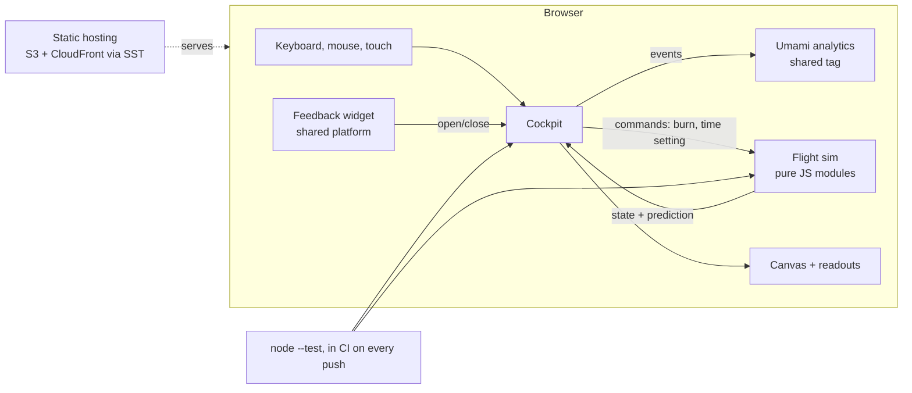

# High-Level Design: Slingshot

## Problem

Gravity assists are one of the most counter-intuitive ideas in spaceflight: a spacecraft gains speed by falling past a planet, and loses it by passing on the other side. Kids aged 7 to 12 meet the idea, if at all, as a diagram and a sentence. Nothing lets them *feel* that a moving planet lends speed, or that where you pass decides whether you get faster or slower.

Slingshot is a browser game in which gravity assists are the movement system. You cannot fly anywhere on your own fuel; you can only borrow speed from planets. The full concept is in `docs/slingshot-context.md` (the "lily pond" brief: a map of drifting star systems reached by chaining slingshots).

A previous attempt that built from the full spec in one pass did not produce a working game. This project therefore grows in small vertical slices, each with a physical acceptance test, and each deployed before the next starts.

## Approach

### Current scope: the first vertical slice

One star, one planet on a fixed circular orbit around it, and one ship. The player steers by changing only the ship's sideways speed, with a small fuel budget. Play alternates between two modes: **paused**, where the player plans a course and sees a prediction line of exactly where it leads, and **running**, where the ship flies it and the screen shows only what is actually happening. The player sees the ship's speed relative to the star; passing behind the planet makes that number climb, passing in front makes it fall. No missions, no map, no story.

### Simulation separate from presentation

The game is split into a pure simulation that knows nothing about the screen and a cockpit that draws the simulation and turns input into commands. The simulation runs in Node with no browser, so physical acceptance tests run as ordinary unit tests. The prediction line uses the same integrator as the live game, on a copy of the state, including any planned manoeuvre, so what the player sees while planning is exactly what will happen when they press play. It is a planning tool, drawn only while paused, and it doubles as a physics debugger.

### Fixed physics step, variable steps per frame

Time control never changes the physics step. Slow, normal and fast differ only in how many fixed steps run per real second; pause runs none. This keeps the trajectory identical at every speed setting.

### True physics, storybook picture

The simulation uses real-world-range values: star and planet masses of real bodies, distances in kilometres, and ship speeds in the tens of km/s, starting around 10 km/s. The screen does not use real proportions. The ship and the planets are drawn at comparable sizes, the way a picture book would draw them, so a kid can see the ship and the planet it is swinging past at the same time. Drawn sizes live only in the cockpit; gravity uses only the physical mass and position, and collision uses only the physical radius.

### Static site, no build step

The game is `index.html` plus plain JavaScript ES modules, served as static files. Nothing is compiled. The only tooling is Node's built-in test runner and the deploy tool.

## Target Users

- **Kid players (7–12).** They need one obvious number that goes up or down, a line showing where they're headed, and controls simple enough to learn without reading. Many first try it on a phone from a shared link, so touch is a first-class input alongside mouse and keyboard.
- **Testers and the developer.** They need to reliably produce both a boost and a brake, and to trust that a surprising result is the physics and not a bug.

## Goals

1. A tester can reliably produce a speed **boost** by passing behind the planet and a **brake** by passing in front.
2. The flyby acceptance test passes: in the planet's frame, the ship's exit speed equals its entry speed within a tight tolerance.
3. Changing the time-control setting does not change the trajectory.
4. The slice is live at `slingshot.andreizimin.com`.

## Non-Goals

- Multiple systems, drifting lilies, map reveal, missions, scoring or narrative. These are later slices.
- Saving progress, accounts or any backend.
- Sound and art beyond simple shapes.

## Tenets

Ordered; when two conflict, the higher one wins.

- **Shipped slice over polish.** When a choice trades finishing and deploying the slice against making it nicer, finish and deploy. Polish is a later slice.
- **Kid-readable over complete.** When deciding what to show on screen, show the one thing a kid needs (a big speed number, a speed arrow, a fuel bar) rather than all the data (vectors, frames, energies). Debug detail stays out of the default view.
- **Exaggerate the picture, never the physics.** When a flyby feels weak or hard to read, fix it on screen (sizes, zoom, slow motion, the prediction line) or by choosing a better real-world-range scenario, never by bending gravity, the integrator, or the numbers under the hood. Real masses and speeds in the tens of km/s; storybook proportions on screen.

## System Design

| Component | Role | LLD |
|---|---|---|
| Flight sim | Bodies, gravity, symplectic integrator, fixed-step time advance, thrust and fuel, prediction line, speed in the star's and planet's frames. No DOM. | `docs/intent/flight-sim/` |
| Cockpit | Canvas rendering with storybook proportions, keyboard, mouse and touch controls, speed readout and arrows, fuel display, time controls. Drives the sim each animation frame. Its decisions live in a pure, tested module (`view.js`). | `docs/intent/cockpit/` |
| Analytics | Shared Umami tag and three cookieless flight events. | `docs/intent/analytics/` |
| Feedback | Shared feedback widget, and keeping game keys out of its form. | `docs/intent/feedback/` |
| Hosting | Static deploy of the site to the subdomain, and CI. | `docs/intent/hosting/` |

The cockpit depends on the flight sim; the flight sim depends on nothing. Visual sizes live only in the cockpit and never reach the gravity calculation.

## Key Design Decisions

| Decision | Chosen | Alternatives | Rationale |
|---|---|---|---|
| Stack | Plain JS ES modules, no build | Vite + TypeScript + Vitest; single inline HTML file | Fewest moving parts for a slice that must ship fast. The sim is still Node-importable for tests, which a single inline file would not be. A bundler can be added in a later slice without restructuring. |
| Test runner | `node --test` | Vitest, Jest | Built into Node; no dependencies. |
| Integrator | Velocity Verlet with a fixed step | Euler; RK4; adaptive step | Verlet is symplectic, so orbits don't spiral and flyby speed is conserved in the planet's frame. Euler gains energy. RK4 drifts over long runs. An adaptive step would make time control and prediction harder to keep identical. |
| Planet motion | Prescribed circular orbit (position is a function of time) | Integrate the planet under the star's gravity | A prescribed orbit can't drift, keeps the scenario reproducible, and the planet's velocity is exact. The ship feels both bodies' gravity; the planet feels nothing. |
| On-screen proportions | Ship and planets drawn at comparable sizes, decoupled from physical radius | True scale; uniformly scaled-up bodies | At true scale the ship is invisible and the planet is a speck next to its orbit. Decoupling drawn size from physics lets the picture be readable without changing a single trajectory. |
| Hosting | AWS S3 + CloudFront with a Route 53 subdomain, provisioned by SST `StaticSite` | Cloudflare, Vercel, GitHub Pages | Matches the developer's existing AWS setup for the parent domain, so DNS and certificates come from the same zone. |

## Release Stages

| Stage | Bar |
|---|---|
| **MVP** ✅ | The first vertical slice is live, the physics acceptance tests pass, and a tester can produce a boost and a brake. |
| **Beta** ✅ | Everything in the MVP, plus: **Umami analytics** (cookieless, with no personal data, because the players are children); the **shared feedback widget** embedded with this project's identifier; a **Linear project** linked, with work tracked as tickets on branches; **automated cockpit tests** alongside the sim tests; and **CI** running `npm test` on every push. |

Work is tracked in the Linear project **Slingshot** (team ZZF).

## Success Metrics

- The flyby acceptance test and time-invariance test pass in CI-equivalent `npm test`.
- In a hands-on session, a tester produces a boost and a brake on purpose within a few minutes, without coaching beyond "go behind it" and "go in front of it."
- **Falsification signals:** speed changes with no flyby; the flight differs from the prediction line shown while planning; the trajectory differs between slow and fast time settings; a flyby feels like nothing happened.

## References

- `docs/slingshot-context.md`: Lily Pond concept brief, physics ground rules, reference numbers.
- EARS syntax: https://alistairmavin.com/ears/
